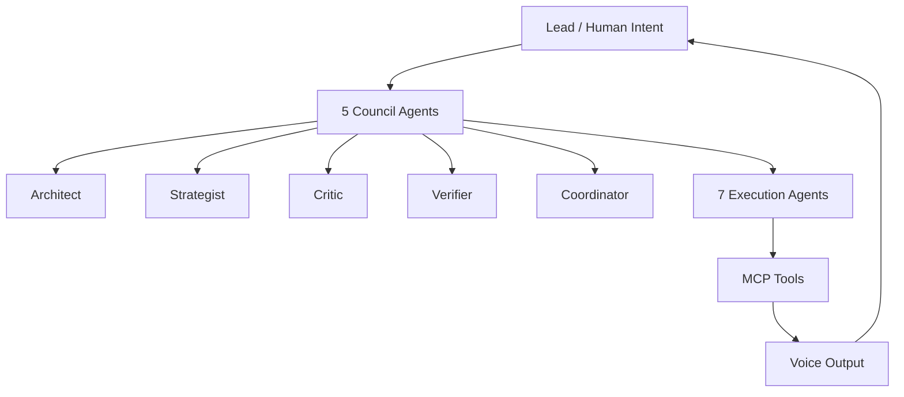

# coding-voice-assistant-mcp

<div align="center">


[](https://github.com/DenverCoder1/readme-typing-svg)

[](https://github.com/kubouchiyuya)
[](https://consulting-payment-tool.vercel.app)

</div>

---

## What This Does

This repository is the MCP edition of a voice-guided coding assistant. It coordinates AI agents through an MCP interface, then uses voice output to make the workflow easier to follow for non-engineers.

It is built for full-cycle execution: intake, planning, critique, implementation, and reporting.

---

## ✨ Features

| Feature | Description |
|---|---|
| 5 council agents | Architecture, strategy, critique, verification, and coordination |
| 7 execution agents | Discrete workers that perform the implementation tasks |
| Voice guidance | Spoken prompts for each step of the workflow |
| Non-engineer friendly | Plain-language explanations and setup prompts |
| MCP-native | Designed around model-context protocol tool workflows |

---

## 🚀 Quick Start

```bash
cd ~/Projects
git clone https://github.com/kubouchiyuya/coding-voice-assistant-mcp.git
cd coding-voice-assistant-mcp
./scripts/settings.sh
```

---

## 🏗️ Architecture



---

## 🛠️ Tech Stack


---

## 👤 Author

<div align="center">

| | |
|---|---|
| **Yuya Kubouchi (MASA2 / MASA Sub)** | Beauty Salon Owner → AI Architect |
| Location | Osaka, Japan |
| System | AKATSUKI / Miyabi Society |
| Identity | AI × Beauty Industry × Non-Engineer |

</div>
