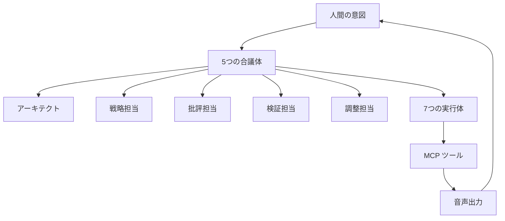

# coding-voice-assistant-mcp

<div align="center">


[](https://github.com/DenverCoder1/readme-typing-svg)

[](https://github.com/kubouchiyuya)
[](https://consulting-payment-tool.vercel.app)

</div>

---

## このツールでできること

このリポジトリは、音声付きのコーディング支援を MCP でまとめたものです。AI エージェントを合議制で動かし、最後に音声で結果を返すので、非エンジニアでも流れを追いやすい構成です。

要件の確認、設計、批評、実装、報告までをひとつの流れとして扱います。

---

## ✨ 機能

| 機能 | 説明 |
|---|---|
| 5 つの合議体 | アーキテクト、戦略、批評、検証、調整 |
| 7 つの実行体 | 実装を担当する個別ワーカー |
| 音声ガイド | 各ステップの進行を音声で案内 |
| 非エンジニア向け | 平易な説明とセットアップ導線 |
| MCP ネイティブ | Model Context Protocol を前提に設計 |

---

## 🚀 はじめかた

```bash
cd ~/Projects
git clone https://github.com/kubouchiyuya/coding-voice-assistant-mcp.git
cd coding-voice-assistant-mcp
./scripts/settings.sh
```

---

## 🏗️ アーキテクチャ



---

## 🛠️ 技術スタック


---

## 👤 作者

<div align="center">

| | |
|---|---|
| **窪内裕也（MASA2 / MASA サブ）** | 美容室オーナー → AI アーキテクト |
| 拠点 | 大阪 |
| 所属 | AKATSUKI / Miyabi Society |
| アイデンティティ | AI × 美容業界 × 非エンジニア |

</div>
